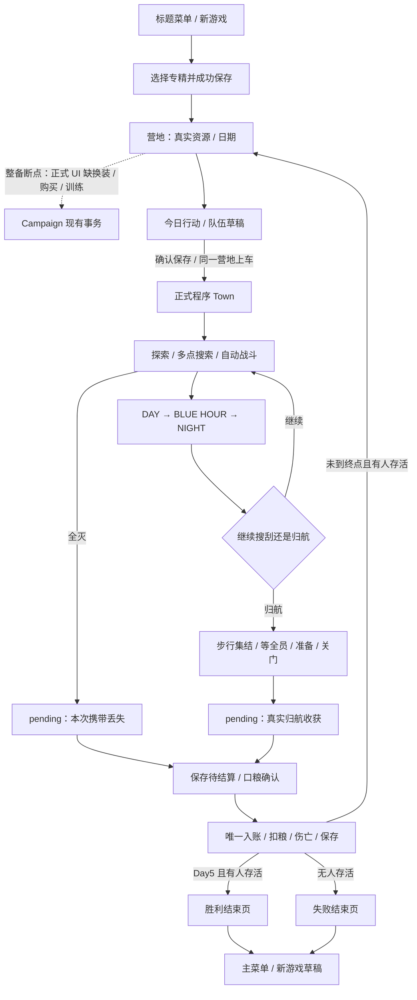

# 蓝时归航：Deadly Days 第一作核心玩法差距审计

日期：2026-10-21，Asia/Shanghai。Task Summary：只读审计当前工作区、复核原作公开资料、运行隔离验证，并提出待批准的下一阶段任务。Changed Files：仅新增本报告；游戏代码、测试、资源、配置、存档协议、运行脚本及 PLAN / VALIDATION 均不修改。以下提议不是已批准的开发计划。

## 1. 执行摘要

**当前是“五日试玩的集成与可玩性验证阶段”。外出行动骨架已成立，但“今天带回的东西改变明天”仍被营地整备入口和正常奖励获取链截断，不能认定为完整可重复游玩的 Roguelite。**

P1-A 已接通营地真实资源、日期；P1-B 已接通胜败结束页、历史成员与重开。当前源码不再存在旧审计 F01 的静态余额和 F02 的终态空页。它们的专项通过不意味着营地换装、经济消费和五日自然胜利也通过。

最大的五个差距：

1. **整备无法兑现收获。** Campaign 有换装、购买、训练事务，正式 CampHUD 却主要是只读展示；角色操作锁定，菜单没有整备入口。废料与武器收益因而缺少可操作的下一日用途。
2. **Run Build 缺少正常获取与选择。** 起始专精确实带一被动、一技能；其余道具/技能主要经 Debug 授予。武器升级候选、应用器有实现，但未成为玩家选择、支付、战斗与 Campaign 保存的完整链。
3. **地点承诺与实际地图、危险、收益尚未统一验收。** 正式地图已经是程序 Town，三行动有真实资源倍率与装备概率；路程星级却按行动 ID 写死，Town 初始人口固定 8–12，不能把配置中的危险梯度直接当实测结果。
4. **五日成长和“再搜一个”的收益曲线缺乏正式路线证据。** 空手归航也有完成 5 XP + 撤离 3 XP；升级阈值总计 18 XP。该结构容易提前耗尽成长空间，但本轮不据此直接断言游戏太简单或修改数值。
5. **当前版本的工程验收不可信。** 老测试仍访问已移除的 UI/固定地点并有真实战斗差异；最近完整 Windows build 失败，现有 EXE 仍是 9 月旧包。修旧断言与恢复真实功能必须分别处理。

优先恢复最小整备并建立当前正式 Town 的五日验收；随后只接一条可正常获得的 Build 奖励，再用路线记录校准资源、成长和夜间返程压力。暂不追求原作的内容数量、Tools、房间、Boss 或长期解锁。

## 2. 审计范围与证据边界

### 2.1 工作区与保护

- 仓库：`D:/my-code/valley-mas`；分支 `master`；HEAD `865edec300e01d64d015924b3e6f391567ba46be`。
- 起点已有 62 项短状态记录；未跟踪目录展开后逐文件明细见 [git-before.txt](../../test-output/gameplay-gap-audit-20261021/git-before.txt)。包括 P1-A / P1-B / 视觉精修及动画等已有成果，不能将它们归为本轮修改。
- 当前没有可调用的 GitNexus MCP；按规则明确退回原生 Git、`rg` 和源码调用链。没有运行索引重建、fetch、切分支、暂存、提交、推送或清理。
- 起点对项目 3,213 个非缓存、非证据、非构建文件记录 SHA-256：[source-before.json](../../test-output/gameplay-gap-audit-20261021/source-before.json)。只读结论包含未提交源码，不代表 HEAD 单独检出后的状态。

### 2.2 阅读范围与方法

已读取根 CLAUDE、项目 AGENTS / PROJECT_CONTEXT、README、PLAN / VALIDATION、[游戏定位契约](../design/game-design.md)、[跨日规格](../archive/2026-10/stages/DAY_LOOP_SPEC.md)、[开局规格](../archive/2026-10/stages/NEW_RUN_SPEC.md)、[今日行动旧规格](../archive/2026-10/stages/TODAY_ACTION.md)、[效果规格](../archive/2026-10/stages/EFFECT_SYSTEM_SPEC.md)、[目录职责](../architecture/project-structure.md)、[搜索规格](../archive/2026-10/stages/EXPEDITION_SEARCH_GAMEPLAY.md)、[武器规格](../archive/2026-10/stages/WEAPON_SYSTEM.md) 及武器升级 W2-4 契约。

复核 [10 月 20 日审计](2026-10-20_project_audit_and_next_phase_plan_report.md)、[P1-A](2026-10-20_p1_a_camp_campaign_binding_report.md)、[P1-B](2026-10-20_p1_b_run_end_screen_report.md)、[视觉精修](2026-10-21_p1_b_visual_refinement_report.md)。旧报告仅用于定位和历史对照；没有把旧通过项自动计入本轮通过数。

源码追踪覆盖 Main → Campaign → Store / Ledger、今日行动 → Town Provider → 搜索注册 / Loot → 自动与指向战斗 → 时钟 / Director / Ambient → 巴士 → pending → commit_day，以及成员 / Trait / XP / 武器实例 / 被动技能 / 营地 / 结束页 / 小地图与探索记忆。

### 2.3 Environment 与隔离方式

`[Windows]` Windows 11 专业版 10.0.26200；Godot `4.7.2.stable.official.ed1daf0bf`，Compatibility；Git 2.39.1.windows.1，Node 26.4.0，pnpm 11.21.0。Node 不在仓库要求的 22.x 范围，`context:recent` 出现 engine warning；这不等同于 Godot 玩法失败。Blender 未使用，本轮不判断其安装状态。`[macOS]` 未访问，Godot / Blender / Node / Git 均未验证。

为避免现有测试硬编码输出覆盖历史证据，复制当前工程到 [独立证据工程](../../test-output/gameplay-gap-audit-20261021/project/project.godot)。代码、测试和运行资源保持原样；**只在该临时副本新增 `override.cfg`，将 user:// 改到专用 `BlueHourGameplayAudit20261021` 目录**。实际确认该目录产生 logs / test-runs。正式工程配置和玩家 `homeward/run.json` 不参与测试写入。

硬件为 NVIDIA GeForce RTX 3060，驱动 32.0.15.9186；完整采样见 [environment.json](../../test-output/gameplay-gap-audit-20261021/environment.json)。副本的 `.gd / .tres / .tscn / project.godot / shader` 与起点相同，见 [副本运行源码一致性](../../test-output/gameplay-gap-audit-20261021/clone-runtime-integrity.json)。

执行入口：[copy-project.py](../../test-output/gameplay-gap-audit-20261021/copy-project.py)、[run-audit-tests.py](../../test-output/gameplay-gap-audit-20261021/run-audit-tests.py)。它们仅为忽略的证据辅助文件，不新增正式测试、不修改断言。副本内 `res://test-output` 为本轮独立输出。每项完整命令、时长、退出码、错误匹配见 [test-results.json](../../test-output/gameplay-gap-audit-20261021/test-results.json)，同目录保留各项 stdout / stderr。

命令模板（实际绝对路径收录在上述 JSON）：

```powershell
# [Windows] 独立副本，不是正式工程路径
& 'C:/Users/A/Downloads/Godot_v4.7.2-stable_win64.exe/Godot_v4.7.2-stable_win64_console.exe' `
  --path 'D:/my-code/valley-mas/apps/blue-hour/test-output/gameplay-gap-audit-20261021/project' `
  --headless --script tests/day_loop.gd

# 原生自动化：屏幕外窗口，隔离存档与合成输入
# 同一引擎和 --path，改为：
--position -3000,-3000 --audio-driver Dummy --script tests/run_end_flow.gd
```

### 2.4 本轮运行结果

主批次执行 32 次：23 次通过、9 次未通过；其中两次属于原生脚本误以 Headless 运行的受限证据。另按原生方式复跑这两组，仍未通过。原始记录全部保留，见 [汇总](../../test-output/gameplay-gap-audit-20261021/summary.json) 与 [原生复跑](../../test-output/gameplay-gap-audit-20261021/native-correction-results.json)。收集器本身最终返回 0 只表示日志收集结束，不表示测试全绿。

按退出码和错误日志共同判定；Godot 返回 0 但出现 SCRIPT ERROR 也不能通过。受控状态、Legacy 流程、正式原生流程分别记录，不会把调用 `_finish()`、瞬移、禁敌或改时钟的夹具写成自然通关。

| 本轮通过项目 | 实际结果 | 证据范围 |
| --- | --- | --- |
| editor import | exit0，227.379 秒 | 全新独立副本导入；非完整 build |
| rules / day_loop / new_run / save_catalog_compatibility | 19 / 43 / 40 / 9 项，均 0 失败、exit0 | 基础、口粮、迁移、备份、规则失败分支；不替代每项玩家 UI 事务 |
| camp_campaign_state / run_end_state | 62 / 138 项，均 0 失败、exit0 | UI 绑定与终态投影；有 API 创建状态 |
| mission_profiles | 4,117 项，0 失败、exit0 | 脚本自标 Phase 0A fixture，验证倍率和语义掉落；不证明正式 Town 初始敌人数 |
| parallel_commands / mission_dayloop / time_contract | 36 / 26 / 173 项，均 0 失败、exit0 | 指挥与受控 Town / Legacy 时钟、撤离、缺员、全灭；含禁敌 / 改时钟 / 受控伤害 |
| weapon_rarity_profile / weapon_upgrade_candidates / weapon_combat_phase1a | 32 / 55 / 11 项，均 0 失败、exit0 | 品质、候选与应用器、基础战斗；升级测试只证明显式扩展序列化，不证明正式库存升级保存 |
| survivor_progression / survivor_xp_gameplay / trait_gameplay | 29 / 6 / 111 项，均 0 失败、exit0 | 等级、单次 XP 与 Trait 消费；含指定敌血 / 搜索进度夹具 |
| survivor_recruitment_roster / camp_roster_recruitment_integration / camp_party | 17 项 / 0 failures（未输出总项数）/ 31 项，均 exit0 | 目录招募、名单、队伍边界；不证明地图营救加入 Run |
| expedition_minimap / exploration | 2,337 / 9 项，均 0 失败、exit0 | 五种子正式几何桥接与探索状态；不是人工地图可读性或性能验收 |
| run_end_flow，原生 | 133 项，0 失败、exit0，111.141 秒 | 正式 main.tscn、真实输入、五次空手出勤 / 上车 / 归航 / 结算后自然缺粮失败；恢复、重开；胜利为 API pending 夹具 |

| 本轮未通过项目 | 实际结果 / 日志 | 当前归类及边界 |
| --- | --- | --- |
| today_action | exit2，107.992 秒；[stderr](../../test-output/gameplay-gap-audit-20261021/today_action.stderr.log) | 旧脚本第37行访问不存在的 `screen.departure` 后计时退出；正式 M08 出发在原生终态流程可用，不能据此说今日行动完全不能打开 |
| search_dispatch | 56 项 / 2 失败，exit1；[stderr](../../test-output/gameplay-gap-audit-20261021/search_dispatch.stderr.log) | 改派后搜索速度，以及旧伤亡返程时限断言失败；根因待复核，不自动改规则或删除断言 |
| weapon_system | 474 项 / 1 失败，exit1；[stderr](../../test-output/gameplay-gap-audit-20261021/weapon_system.stderr.log) | 旧断言要求 K9 的 model_path 为空，当前已有模型；是资源契约漂移，不是这把武器不能射击 |
| effect_system | 324 项 / 19 失败、另有 `corner` 访问错误，exit1；[stderr](../../test-output/gameplay-gap-audit-20261021/effect_system.stderr.log) | 同时含自动 / 指向伤害、目标倍率、移动速度、冻结时换弹精确值与旧地点问题；focus 命中倍率缺口可与源码对应，其余分别待复核 |
| day_loop_flow | exit2，127.850 秒；[stderr](../../test-output/gameplay-gap-audit-20261021/day_loop_flow.stderr.log) | `corner / van_south / garage` 路线和装备断言失败后超时，没有完整成功汇总；默认 Legacy 三人夹具，不能代替正式 Town 五日成功 |
| new_run_flow | exit2，122.006 秒；[stderr](../../test-output/gameplay-gap-audit-20261021/new_run_flow.stderr.log) | 旧地点搜索失败、等级仍应为2的旧预期与当前自动 XP 不一致后超时；未完成三专精五日验收 |
| camp_ui_runtime，原生 | exit1，21.667 秒；[stderr](../../test-output/gameplay-gap-audit-20261021/camp_ui_runtime.stderr.log) | 当前再次复现第114行 `member_buttons` 与第23行旧 PowerSlots 契约失败，是当前完整 build 的已知前置阻断 |
| effect_runtime，原生复跑 | exit2，90.112 秒；[stderr](../../test-output/gameplay-gap-audit-20261021/effect_runtime-native.stderr.log) | F1 在新 Camp 没有旧 toggle_debug 消费者；再访问旧 `effect_buttons` 后退出；不能当正式道具管理已验证 |
| camp_interaction，原生复跑 | exit2，180.689 秒；[stderr](../../test-output/gameplay-gap-audit-20261021/camp_interaction-native.stderr.log) | 旧按钮文字定位失败，访问旧 `drawer`；没有完成换装 / 训练 / 设施的原生验收 |

方法纠正：最初把 `effect_runtime`、`camp_interaction` 也放入 Headless 批次；它们包含原生截图等待，不能算有效视觉验收。前者 exit2，后者由收集器 150 秒超时终止（无正常退出码）；其日志保留，随后原生复跑结果如上。没有把两次错误调用算作新增玩法缺陷，也没有用原生复跑掩盖原失败。

当前原生证据：[流程 JSON](../../test-output/gameplay-gap-audit-20261021/project/test-output/p1-b-run-end-20261020/flow-runtime.json)、[自然五日缺粮失败 1600×900](../../test-output/gameplay-gap-audit-20261021/project/test-output/p1-b-run-end-20261020/actual-five-day-loss-1600x900.png)、[自然失败 1024×640](../../test-output/gameplay-gap-audit-20261021/project/test-output/p1-b-run-end-20261020/actual-five-day-loss-1024x640.png)、[受控 pending 最终胜利](../../test-output/gameplay-gap-audit-20261021/project/test-output/p1-b-run-end-20261020/controlled-final-victory-1600x900.png)。本轮目视检查两张 1600×900 图，确认实际状态、成员与操作区域可见；没有把这次检查当作全部人数布局或用户审美验收。

报告收尾：定向 encoding-guard 与 `git diff --check -- apps/blue-hour` 通过；[交付检查](../../test-output/gameplay-gap-audit-20261021/delivery-checks.json) 确认 3,213 个原有文件哈希不变、原有 Git 状态完整保留、只新增本报告，34 行系统矩阵均采用约定状态，本地链接目标存在。没有遗留本轮 Godot 测试进程，没有修改或同步现有计划。

### 2.5 未验证范围

未进行人工盲玩、原作本机游玩、完整自然五日胜利、多专精多种子正式 Town 五日路线统计、长期帧时间 / 内存压力测试或当前新 EXE 独立验收。没有新增功能，因此不执行会产生交付物的完整 build；最近 build 只作为历史材料，当前具体阻断另用原生测试复核。仅本报告新增，PLAN / VALIDATION 按本轮明确边界保持不动。

最近完整 build 是 2026-10-21 20:01:58～20:10:39（+08:00），520.932 秒、exit1，见 [原结果](../../test-output/p1-b-visual-20261020/build.result.json)。本轮对照其 773 个源码 / 脚本文件哈希全部相同，见 [对照结果](../../test-output/gameplay-gap-audit-20261021/previous-build-source-comparison.json)，但这仍是同日较早的构建执行记录，不伪称本轮重跑。

现存 EXE 为 2026-09-24 的 1,730,183,136 字节旧包，SHA-256 `e194539e347e5b2757b4c61107e2ebbad98352dc44ae43fe7a40d0e26951b627`；BUILD-INFO 的 `fullBuildPassed=false`，见 [旧产物当前核对](../../test-output/gameplay-gap-audit-20261021/existing-exe.json)。本轮没有导出或启动它，不把旧菜单启动记录当作当前玩家闭环交付。

## 3. 原作参考基线

检索对象始终为 Pixelsplit 2019 年第一作 **Steam App 740080**。该 App 的新闻流夹杂 Roadtrip 宣传；只采用明确指向第一作的商店内容与 2019 / 2020 原作更新，不采用 Roadtrip 的单人、背包邻接、燃油路线机制。

| 参考点 | 本轮公开证据与可靠程度 | 使用边界 |
| --- | --- | --- |
| 管理小队、自动战斗与战术控制 | [2019 官方补丁记录](https://steamcommunity.com/app/740080/discussions/2/2530372519562025858/) 明确随鼠标、Ctrl 停步攻击；[2024 开发者键位回复](https://steamcommunity.com/app/740080/discussions/2/4756451565238038346/) 确认目的地、镜头与暂停 | 官方直接证据；不推导传统 RTS 自由编组 |
| 搜刮、程序城市、夜间追贪风险 | [官方商店页](https://store.steampowered.com/app/740080/Deadly_Days/)；[2019 发布更新](https://store.steampowered.com/news/posts/?appgroupname=Deadly+Days&appids=740080&enddate=1569421769) 说明夜间更快升级且不再奖励额外点数 | 官方已核实；蓝时专名和五日目标属于本作原创 |
| 食物压力、Traits、训练、不同任务、能力槽 | [官方 0.50 记录](https://steamcommunity.com/app/740080/discussions/2/2530372519562025858/) | 已核实结构；每日每人精确口粮数、最终版全部冷却参数本轮不作原作事实断言 |
| 地点规模 / 收益 / 危险选择，巴士返程，多人分工 | [Games Asylum 2021 实玩评测](https://www.gamesasylum.com/2021/09/04/deadly-days/) | 真实游玩文字佐证，非本轮亲自实机；精确三选一数量、所有并发边界仍待原作实机复核 |
| 武器随机改造、物品与特殊能力组合 | [官方商店页](https://store.steampowered.com/app/740080/Deadly_Days/) | 已核实 Build 方向；不照搬数量、数值和物品内容 |
| 轻量房间、Tools 与自定义武器 | 官方商店明确 1.5 房间；[官方 1.5 链接](https://steamcommunity.com/games/740080/announcements/detail/2378411445034338636) 本轮抓取仅返回图片，细节由 [SteamDB 官方公告镜像](https://steamdb.info/patchnotes/5173172/) 读取 | 明确区分官方链接可访问与正文由镜像读取；这是原作后续扩展，不是本作五日切片前置条件 |

待核实：原作最新版本的任意武器转交全部限制、室内受伤 / 中断进度细则、精确每日候选数、每个任务的路程公式与结算参数。项目 [既有原作操作研究](../archive/2026-10/stages/DEADLY_DAYS_CONTROLS_RESEARCH.md) 可帮助定位，不能替代本轮原作实机。

本作应保留：3D 小队、正式二次元幸存者、BLUE HOUR 临界预警、全员巴士归航、首次缺粮宽限、五日终点。无需复制原作汉堡故事、Boss、房间名称或无限扩展的内容量；也不应转成单人射击或背包拼图。

## 4. 本项目玩法差距矩阵

状态只评价该行范围。“当前玩家闭环已验证”必须有正式入口与效果 / 保存证据；数据测试通过不能代替玩家操作链。表中脚本名对应本轮同名日志；未复跑的证据明确标历史。

### A. 核心每日循环

| 系统 / 原作参考点 | 状态 | 当前入口与证据 | 玩家差距、风险与建议 |
| --- | --- | --- | --- |
| 菜单 → 新 Run → 营地 | 当前玩家闭环已验证 | [Main](../../core/main.gd) `show_new_game / confirm_creation`；[新游戏页](../../ui/new_game_screen.gd)；本轮 run_end_flow 的真实输入，new_run 规则 | 起始池仅两名、抽两人，主要随机顺序；不等于组合随机。扩大池是内容决策，不先造新职业系统 |
| 每日资源驱动选地点 | 部分实现 | [今日行动](../../ui/today_action_screen.gd)、[TodayActionData](../../data/today_action_data.gd) `make_map / modify_loot / encounter_rules`；三 `.tres`；mission_profiles 为明确夹具 | 倍率、装备概率真实；卡片星级与近中远按 ID 固定，未与当前 seed 路线相联。应先验证承诺与实跑一致 |
| 外出 → 返回 → 结算 → 下一天 | 部分实现 | [Mission](../../missions/mission.gd) `command_extract / _finish` → [Main](../../core/main.gd) `_mission_complete / return_to_shelter` → [Campaign](../../core/campaign.gd) `stage_result / commit_day` | 空手五日失败链可验证；不能据此证明正式 Town 搜索、成长并自然胜利。补当前地点定位的正式路线验收 |
| 时段与追贪撤离 | 已实现但当前未验证 | [Clock](../../time/mission_clock.gd)、`Mission._advance_world / _on_phase`、[Atmosphere](../../blue_hour/atmosphere.gd)；time_contract / mission_dayloop 受控检查 | 阶段、噪声、增援与返程等待有机制；“值得多搜一次”的主观压力未由规则测试证明。先记录返程距离、损失和增量收益 |
| 胜败、终态恢复与重开 | 当前玩家闭环已验证 | [RunEndSummary](../../ui/run_end_summary.gd)、[共用结束页](../../ui/run_end_screen.gd)、[动态成员卡](../../ui/run_member_result_card.gd)；run_end_state / run_end_flow | 不再是 F02 空页；胜利末次 pending 来自夹具，不能算自然胜利。历史损失按 ID 与原因显示，缺记录显示不详 |

### B. 小队控制与战斗

| 系统 / 原作参考点 | 状态 | 当前入口与证据 | 玩家差距、风险与建议 |
| --- | --- | --- | --- |
| 整支小队移动、掩护、集合 | 已实现但当前未验证 | [SquadInput](../../missions/squad_input.gd)、`Mission.guards / command_move / command_stop / command_recall_all`；parallel_commands；原生归航输入 | 仍为指挥小队，WASD 控镜头；没有改成单人 TPS。持续按键、失焦和极端拥堵本轮未完整复验 |
| 多点派遣与搜索自卫 | 部分实现 | [SearchTask](../../missions/search_task.gd)、`Mission.search_tasks / survivor_tasks / command_search`；search_dispatch 当前失败与 parallel_commands 分开报告 | 每目标一人、每人一任务，可零掩护；建筑隐藏 / 车辆自卫规则存在。旧失败须区分路线和规则，不能靠限制并发规避 |
| 自动射击、弹药、射程与武器差异 | 部分实现 | [WeaponCombatController](../../weapons/weapon_combat_controller.gd) `try_attack / tick`；[InstantHitResolver](../../weapons/combat/instant_hit_resolver.gd)；weapon_combat_phase1a | 弹药是弹匣 / 自动换弹，非额外基地弹药货币。正式换装未接回，玩家很难调整协同；先恢复装备链 |
| 自动与 Ctrl 指向命中的效果一致 | 存在已复现缺陷 | [AimFire.fire](../../survivors/aim_fire.gd) 不传 target → `try_attack` 先按 `damage_to(member, null)` 建规格；[Mission.damage_to](../../missions/mission.gd) 按 target 判断 Trait / focus | 命中时才知道对象，提前计算会漏依赖目标的倍率。effect_system 的具体失败另列，不能把整组错误都归此因；需要同目标对照 |
| AI、噪声、夜间追击 | 已实现但当前未验证 | [Enemy](../../enemies/enemy.gd)、[Director](../../encounter/encounter_director.gd)、[Ambient](../../encounter/ambient_threat_runtime.gd) | 正式 Director 与 Ambient 都只生成 `ENM_001_infected_basic_a`。行为状态、听觉、增援有基础，但危险升级主要是同型压力，非特殊敌人应对变化；先证明基础压力有效，再扩一种行为 |
| 战斗反馈与归航危险 | 已实现但当前未验证 | [WorldInteractionVFX](../../missions/world_interaction_vfx.gd)、武器 fired / hit_resolved、[Soundscape](../../audio/soundscape.gd)、`_update_extraction` | 有音效、命中 / 开火、准备倒计时；关门后 Director 停增援、角色进入 boarding，这是否符合预期可另测。不可把缺少新特效当核心缺口 |

### C. 武器、物品与 Build

| 系统 / 原作参考点 | 状态 | 当前入口与证据 | 玩家差距、风险与建议 |
| --- | --- | --- | --- |
| 武器个体、品质、词条与掉落 | 部分实现 | [Equipment](../../core/equipment.gd) `roll / create / resource`、[WeaponInstance](../../weapons/weapon_instance.gd)、[WeaponRegistry](../../data/weapon_registry.gd)；`reward_for_site / _update_pickups` | 八种武器定义与独立 UID 存在；掉落概率与地点语义真实。正式任务池仍主要 P9 / K9 / 短刀；目录八把不等于都可自然获得 |
| 自由装备、转交、卸下、库存与购买 | 底层已实现，玩家闭环未完成 | Campaign `equip_weapon / unequip_weapon / buy`，Main `equip_member / buy_weapon`；[营地适配器](../../ui/camp_hud/survivor_roster_adapter.gd) `action_states` 全锁定 | API 转交会解除旧持有人，不能按 README 宣称自动交换两把。当前正式 HUD 缺消费者。恢复已有事务，不重写库存系统 |
| 武器升级候选 → 应用 → 战斗 → 保存 | 底层已实现，玩家闭环未完成 | [候选器](../../weapons/upgrade_candidate_generator.gd)、[应用器](../../weapons/weapon_upgrade_applier.gd)、[三 P9 资源](../../data/weapon_upgrade_registry.gd)；weapon_upgrade_candidates | `to_dict(true)` 的扩展往返不是 Campaign 保存闭环；Inventory 使用默认 `to_dict()`，升级历史在正常入库时不写入。应先评估 schema / 验证 / 备份，再开放 UI，不自动照旧报告升级 v6 |
| 被动、技能、Trait 组合 | 部分实现 | Campaign `new_run / passive_modifiers / equipped_effects`、[EffectModifiers](../../core/effect_modifiers.gd)、[SpecialPower](../../missions/special_power.gd)、`data/effects` | 起始套餐效果真实；额外持有 / 槽位 / 升级依赖 API 与 Debug。正常搜索未发放被动 / 技能。先做一条可获得、可选、可保存的奖励链 |
| 能力冷却与使用次数 | 部分实现 | `SpecialPower.can_activate` 检查 active / cooldown，却不限制 used_today；Effect Resource 提供冷却，状态每日重建 | 当前按冷却可再用，与若干旧文档“每日一次”不一致。先确认本作希望采用哪条规则，不能把原作或旧文档直接覆盖当前行为 |

### D. 资源经济与生存压力

| 系统 / 原作参考点 | 状态 | 当前入口与证据 | 玩家差距、风险与建议 |
| --- | --- | --- | --- |
| 搜索 → 地面掉落 → 拾取 → 归航带回 | 部分实现 | [LootSpawner](../../maps/generation/loot_spawner.gd)、[LootResolver](../../core/loot_resolver.gd)、[Ledger](../../core/run_ledger.gd)、`Mission.resolve_site_loot / _update_pickups` | 真正货币只有 food / scrap；medical / fuel / tools 是掉落 profile 名，不能当药品、燃料、Tools 已实现。需正式路线核对“搜完”与“拾取”差异 |
| 口粮、饥饿、留守与成员损失 | 当前玩家闭环已验证 | `Campaign.preview / commit_day / health_multiplier`；day_loop；原生五日空手归航 | 每位仍活成员含留守每日 1 粮；首次缺粮生命上限 .8，连续缺粮才减员。不是原作即刻死亡规则，应保留原创宽限并显示后果 |
| 全灭与重复结算保护 | 已实现但当前未验证 | `Ledger.finish` settled；Campaign pending 守卫；Main 保存后推进；mission_dayloop / day_loop | 全灭丢本次携带物资，战死丢持枪，饿死留库存；UI重复进入不可入账。底层和受控伤害不能冒充自然战斗平衡 |
| 废料用途与食物训练 | 底层已实现，玩家闭环未完成 | `buy / train / training_cost`、`day_loop.tres / new_run.tres`；正式 Camp 无交易入口 | 不应说 Scrap 没有任何规则用途；准确说当前入口缺失使用途无法兑现。先接回消费，再考虑是否需要第二种资源 |
| 资源 HUD 的决策可信度 | 已实现但当前未验证 | [CampHUDRoot.refresh_campaign_state](../../ui/camp_hud/camp_hud_root.gd)；本轮 camp_campaign_state 62 项；P1-A 原生 186 项是同源码历史证据，本轮未重跑全部 HUD 刷新入口 | 读取当前 Campaign 引用，不复制余额；情报无字段显示 —。P1-A 解决旧 F01，但不能替代行动卡危险 / 路程真值 |

### E. 跨日成长与单轮结构

| 系统 / 原作参考点 | 状态 | 当前入口与证据 | 玩家差距、风险与建议 |
| --- | --- | --- | --- |
| XP、等级与 Trait 成长 | 部分实现 | [SurvivorProgression](../../data/survivor_progression.gd)、Campaign `add_xp / member_trait / _award_outcome_xp`、Mission `award_xp_once`；survivor_progression / survivor_xp_gameplay | 搜索 / 击杀 / 完成 / 撤离有来源；空手也 8 XP，累计 18 XP 可到 Lv5。训练和自然成长的价值可能挤压，须实跑后调平 |
| 队伍变化、营救与招募 | 底层已实现，玩家闭环未完成 | Campaign `discover_survivor / recruit_survivor` 仅更新 survivor_states；[RosterManager](../../data/survivor_roster_manager.gd)；recruitment 专项 | “已招募角色目录”不是本轮 members；`rescue` 是生成类别，objective 仍 SEARCH_AND_RETURN。没有正常营救 → 新 Run 成员 → 口粮 / 装备 / 历史登记链 |
| 安全屋意义与设施 | 部分实现 | [ShelterView](../../ui/shelter_view.gd)、CampHUDRoot、[CampMenuOverlay](../../ui/camp_menu_overlay.gd)、camp/ | 常驻场景、成员展示、出发演出成立；M06 临时增益 / 医疗支援仅发本地信号。房间模型、设施描述符不代表建造和产出系统 |
| 五日目标与可重复游玩 | 部分实现 | `day_loop.tres end_day=5`；Campaign `commit_day`；原生自然失败与受控胜利；旧五日专项当前另列 | “有终点”已实现；“正常路线自然赢且有多种选择”未证明。优先补正式 Town 五日成功和连续重开验收 |
| 长期解锁 / 城市侵蚀 / 双主线 | 暂缓 | [PROJECT_CONTEXT](../../PROJECT_CONTEXT.md) 长期目标；当前核心状态与消费链无对应完整实现 | 不纳入五日完成门槛，不用长期系统补当前整备断点 |

### F. 地图与探索

| 系统 / 原作参考点 | 状态 | 当前入口与证据 | 玩家差距、风险与建议 |
| --- | --- | --- | --- |
| 程序布局、建筑、POI、返程 | 部分实现 | [MapProvider](../../maps/expedition/expedition_map_provider.gd)、[TownAdapter](../../maps/expedition/town_runtime_adapter.gd)、[TownGenerator](../../maps/town/town_generator.gd)、[LandUse](../../maps/town/town_land_use.gd)、[SearchRegistry](../../maps/expedition/town_search_registry.gd) | 正式指定 PROFILE_A_MAIN_STREET，seed 改建筑 / 到达点 / POI 等；不是 README 的固定旧城，也不是全部蓝图均进入正式池。补 seed 可达性和收益路线样本 |
| 搜索点时间、分布与可达性 | 部分实现 | Registry `resolve_navigation_background / resolve_priority`；LootSpawner 4 / 8 / 12 / 18 秒；mission_profiles / 搜索专项 | 未解析、可达、不可达有状态，不能把注册总数当一定可搜总数。点位差异和距离已有空间基础，尚缺玩家承诺的一致预览 |
| 小地图、迷雾与探索记忆 | 已实现但当前未验证 | [MiniMap](../../ui/expedition/minimap.gd)、[Exploration](../../maps/exploration.gd)、[ExplorationState](../../maps/exploration_state.gd)；expedition_minimap / exploration | 有静态几何快照、活体标记和独立探索文件；缓存不是 Campaign 原子事务的一部分。地图 identity 含 namespace，但正式默认空，Run 隔离 / 重试记忆政策待核实 |
| 行动的玩法差异 | 部分实现 | 三 TodayActionData 使用最终 loot 倍率和语义装备点；生成 mission_type 与 objective 分离 | 并非仅换皮，但三者都搜刮返程；没有真正营救 / 医疗 / 被动奖励目标。先校准三行动，再决定是否加第四类 |

### G. 表现与可读性

| 系统 / 原作参考点 | 状态 | 当前入口与证据 | 玩家差距、风险与建议 |
| --- | --- | --- | --- |
| 时间、危险、搜索、成员和撤离信息 | 部分实现 | [MissionHUD](../../ui/mission_hud.gd)、ui/expedition/、Clock / SearchTask / board_count 真值 | 实现时段、Toast、搜索卡、人数与准备；UI 信息存在不代表在压力中看得懂。路线验收观察遗漏拾取、迷路、未看预警，不再先扩面板 |
| 结束页美术与动态名单 | 已实现但当前未验证 | 当前 RunEndScreen / Card；本轮正式终态截图；[视觉报告](2026-10-21_p1_b_visual_refinement_report.md) 历史 1–12 人 / 两窗口 | 已有独立滚动、固定按钮和正式头像；本轮不重复完整视觉精修验收。未获用户视觉认可不写成审美达标 |
| 角色模型与动画 | 已实现但当前未验证 | SurvivorDefinition 绑定模型 / 头像；[动画控制器](../../survivors/survivor_expedition_animation_controller.gd)；工作区有动画相关既有改动 | 本轮不修改、不重做全部动作专项，也不以模型数量推导玩法深度 |
| 性能与 Windows 当前产物 | 待核实 | runtime load profile / 避让节流 / pool；[run.ps1](../../run.ps1) 和 camp_ui_runtime | 不能用截图或导入成功代替帧时间、独立 EXE 与五日验收。当前旧包信息见下文 |

## 5. 当前玩家核心循环图



通过范围：本轮规则、受控 Town 归航边界，以及正式原生空手跨日至自然缺粮失败 / 续档 / 重开子链。**完整有搜索、有奖励、有换装、有自然昼夜风险并最终胜利的五日玩家链仍未验证。** 图表示实现关系，不把每条箭头均涂成通过。旧 Legacy 固定地点测试也不能替代正式 Town。

## 6. 机制深度评估

| 决策 | 现在能成立的部分 | 尚不能认定成立的部分 | 最小验证办法 |
| --- | --- | --- | --- |
| 今天去哪 | 食物 / 废料倍率、装备概率和刷怪间隔不同，食物是真正日消耗 | 废料消费入口缺失；近远与危险星级没有当前地图证据；初始敌人固定 | 同 seed / 同队伍 / 同路线策略跑三行动，记录可达点、粮、废料、装备、敌人数和返程时间 |
| 再搜一个还是回家 | 搜索花时间，远离巴士，噪声吸引敌人，夜间增援加快，全灭损失收益 | 没有当前正式路线统计支持“最后一个点有诱惑且可判断”；建筑隐藏可能降低实际风险 | 早归 / 蓝时归 / 再多一点三策略配对记录；同时记录未拾取掉落，禁止只算搜索完成 |
| 怎么站、谁去搜 | 掩护与并行搜索争用成员，射程 / 弹匣 / 近远程有差异 | 起始固定两人、缺少正式换装；只有一种正式敌人；目标依赖伤害差异干扰判断 | 恢复换装后同 UID 武器交换对照自动 / Ctrl / 遮挡 / 搜索 / 撤离 |
| 怎么组成 Build | 专精套餐、Trait 等级、随机武器属性、冷却技能确有消费点 | 新被动 / 技能无正常取得，升级无完整保存；很难在 Run 中改变方向 | 仅选一个现有效果奖池，正常搜到后真实选装，下一次出勤测效果并续档 |
| 食物保命还是投资 | 口粮与训练共用食物，战死 / 饥饿的装备后果不同 | 训练入口缺失且完成经验较高，可能压缩投资窗口 | 先记录空手、两点补给、装备路线 XP 和口粮，再决定 XP / 训练 / 收益参数，不先设新币种 |
| 一轮是否有变化 | 等级、资源、装备库存、减员、地图 seed 会变化，五日目标明确 | 没有自然通关与多个可行策略证据；固定角色组合和追加奖励缺失使变化集中于数值 | 三专精、多个固定种子的正式五日回放，保存每日日志；自动化后再做人工新手体验 |

源码确定的成长结构：Lv1→5 阈值为 2 / 3 / 5 / 8 XP；成功返回者每次至少获得完成 5 + 撤离 3。因此不搜索、不击杀也可累计 8 / 16 / 24 XP，第三次返回已超过总阈值 18。这是规则推导，不是本轮逐路线实测平衡结论。食物仍会消耗，不能进一步推断“空手可赢”。本轮自然空手路线的预期恰是第 5 日连续缺粮失败。

还有两个容易混淆的所有权问题：

- `Campaign.members` / `roster` 是实际 Run 身份与成长；`survivor_states` 是角色目录发现 / 招募状态。后者通过测试不等于实际加入小队，更不等于营救玩法完成。
- `WeaponInstance.to_dict(true)` 可保留升级字段，但 Campaign 目前通过默认旧格式入库 / 复制；`_normalize_weapons` 的 merge 不会删除原字典已有扩展字段，不能误写成所有加载必然抹掉升级。真正需要闭合的是写入路径、严格验证、候选生命周期和 UI 事务。

营地另有两项展示边界：`SurvivorRosterAdapter.build()` 遍历的是已招募目录，另带 `is_party_member`，不是纯 `Campaign.members`；当前状态文字统一“已招募”，因此不能把侧栏数量解释为本轮生还人数。其 `_detail_data()` 又将同一个生命比例生成的 `attribute_base` 填入生存、火力、团队支援、机动四条能力条，这不是四种实际能力的独立计算。恢复整备时应先区分“角色目录 / 本轮成员 / 外勤队伍”的语义并显示可信数值，不据这些占位指标制定平衡。

三行动也不是全部危险参数失效：Town 初始人口由 Ambient 固定 8–12，但后续 Director 仍消费行动修饰后的刷怪间隔和批次。当前可确定的是“初始敌人比例不能直接证明正式 Town 的初始危险梯度”，不能扩张成“三行动敌情完全一样”。

目标伤害缺口的修复边界也应落在真实命中对象：不能只让 Ctrl 调用方传入一个猜测目标，因为自动射击可能先打中挡在前方的另一名敌人，穿透也可能命中多名对象。当前 InstantHitResolver 复用同一份预先计算的 `spec.damage`。后续应对每个真实命中对象验证 Trait、距离和 focus 条件，同时保持每发 / 每弹丸 / 穿透衰减的语义；该项是根因分析与建议，本轮没有实施。

## 7. 问题分级

| ID / 级别 | 问题与当前证据 | 对玩家的具体影响 | 处理边界 |
| --- | --- | --- | --- |
| ENG-01 / P0 发布阻断 | camp_ui_runtime 访问旧 member_buttons，要求旧能力栏；最近完整 build exit1 | 无法交付与当前源码对应的可信新包 | 先逐条分类旧定位 / 真实缺功能；恢复行为后改定位，不能删断言或绕门禁 |
| LOOP-01 / P1 | 当前营地 action_states 禁用，Main 旧事务无正式消费者 | 搜到枪不能正常换，攒 Scrap 无法消费，整备缺意义 | 最小换装 / 卸下 / 转交，再购买与训练；分别验证保存失败 |
| LOOP-02 / P1 验收缺口 | 旧五日流程与正式地图 / 新成长契约失配；自然五日胜利未证实 | 不知道五天是否可稳定完成和重玩 | 用正式 Town 动态 ID 和语义查找；不能靠固定阵容无敌 / 注入奖励过关 |
| COMBAT-01 / P2 | Ctrl 在命中前以空 target 算目标相关伤害；效果测试具体失败需分案 | 自动与指向策略价值不一致，Build 说明不可靠 | 同目标命中后解析倍率；不得改全局伤害来掩盖 |
| BUILD-01 / P2 | 被动 / 技能额外获取、装备管理和升级链不闭合 | Run 很难形成玩家选择的组合 | 接一条现有内容奖励，不同时扩新道具、设施和材料 |
| UPGRADE-01 / P2 开放前阻断 | 默认实例序列化不含升级字段，Inventory 调用旧形式 | 若贸然开升级可能看似成功、入库变回基础形态 | 先评估数据所有权、严格校验、迁移与备份，再接收费 UI |
| ECON-01 / P2 待平衡 | 空手固定 XP、粮食训练与五日上限关系；三行动实际难度缺路线数据 | 可能无效训练、过早满级或单一最优地点 | 当前证据不足以直接改奖励；先收配对路线样本 |
| INFO-01 / P3 | 路程星级按 ID；危险意图与 Town 初始人口不同来源；营地 M06 本地信号 | 玩家可能把装饰或意图当真实能力 / 测量 | 区分估计与实测，接真状态或明确暂未开放 |
| DEBT-01 / P3 | README / TODAY_ACTION 仍描述固定旧城、旧入口；多测试访问已移除字段 | 维护与验收定位失真，不是新玩法不足 | 在后续授权的工程闭环中单独更新现行说明，不覆盖历史报告 |
| LONG-01 / P4 | 城市侵蚀、设施、营救补员、正式主线、多平台 | 当前五日切片无需全部具备 | 先完成上述闭环；营救涉及实际成员登记，不能只解锁目录 |

本轮没有证据证明新的玩家存档丢失或重复入账；不得凭潜在风险登记“已复现数据损坏”。升级旧格式是明确阶段边界，只有接入玩家升级前才成为必须解决的数据风险。

## 8. 下一阶段路线图

路线图全部为建议，未写入 PLAN。工程任务与玩法任务分开验收，避免把“门禁绿”当作“有趣”。

| 顺序 / 类型 | 目标与当前依据 | 涉及模块 / 小步骤 | 依赖与风险 | 验收与测试方法 |
| --- | --- | --- | --- | --- |
| E1 / 工程 P0 | 恢复可信门禁，ENG-01 | 逐个记录失败；将旧 UI / 地点定位改为当前公开语义；真实缺功能移交 G1；保留每条行为断言；跑受影响专项再全 build | 与 G1 有行为依赖；不能把禁用功能通过改测试写成已完成 | 无 SCRIPT ERROR；失败均有根因；完整 build、独立新 EXE 菜单 / 外出 / 终态实际启动，记录 source manifest / EXE hash |
| G1 / 玩法 P1 | 恢复最小整备，LOOP-01 | ①库存查看和 UID 换装 / 卸下 / 转交；②今日固定货单购买；③食物训练。逐条复用 Campaign + Main 保存事务 | P1-A 已在；UI 重建可能丢选择，付款失败不能先保留收益 | 真实搜到 / 购买的武器下一次 Mission 使用；取消无变化；保存失败全量回滚；重复点击一次；续档一致；两窗口原生输入 |
| E2 / 工程 P1 | 正式 Town 五日验收，LOOP-02 | 单次动态目标搜索拾取归航 → 续档下一天 → 五日成功 → 自然失败 / 单人 / 重开；旧 Legacy 专项保留其定位 | G1 与已有终态页；风险是用内部 finish 或固定旧点冒充正式路径 | 正常伤害 / live director / 真实行走与上车 / 唯一 pending 与 history；不给 Debug 奖励；区分受控边界和自然路线 |
| G2 / 玩法 P2 | 一条现有被动或技能奖励获取链，BUILD-01 | 先选定小奖池和一个现有语义搜索点；携带 / 归航入账；库存选择 / 装备；出勤真实效果 / 存档；失败不给奖励 | G1、效果命中一致性；容量满须有明确保留 / 替换方案 | 真实领取一次、取消不吞旧物、重复不复制、全灭不入账、续档仍持有、效果可测，不改全局专精 |
| G3 / 玩法 P2 | 三行动和五日风险收益校准，ECON-01 | 先记录承诺 / 点位 / 战斗 / 时间 / 拾取 / 粮与 XP；配对路线；识别支配策略后逐项调参数；最后人工体验 | G1、E2，G2可后接；不要用新敌人和新材料掩盖原曲线 | 同条件可比较，多种子和三专精；失败 / 意外无效路线如实入样；参数修改前后同路线回归；不预设胜率保证 |
| E3 / 工程与规则 P2 | 目标伤害与升级数据接线 | 分别建立 auto / Ctrl 对照、升级库存 / 候选 / 复制 / pending / 历史 roundtrip；冻结数据方案后逐步实现 | 升级 UI 未开放前可排后；存档变化必须另评估 | 倍率同目标一致，基础模板不变；旧档精确备份、无效状态拒绝、保存失败回滚，不能只验证 to_dict(true) |
| P3 / 反馈 | 可读性与性能 | 真路程提示 / 时段和伤亡原因 / 受伤与拾取反馈；目标数量、AI数量和加载耗时分开量测 | 核心规则先稳定；避免一次换整个 HUD | 两窗口可读性和操作；实际帧时间、内存与长行动记录，视觉与工程分开报告 |
| P4 / 长期 | 营救、房间、城市侵蚀、更多内容、正式结局和平台 | 从最能强化既有取舍的一项开始，各自小切片 | 不作为当前试玩前置；营救须先评估 Run ID / 历史 / 口粮 / 存档 | 每项有正常获得和使用链，再谈数量与长期解锁 |

**工程闭环应先恢复到可相信的程度，再扩大玩法。** 可以并行做一项边界明确的“路线观察原型”：使用现有内容比较早归 / 蓝时归 / 追贪，只产出数据和结论，不改正式经济、存档或再建一套战斗。当前不建议同时开发武器升级、营救、设施三个系统；它们共享尚未闭合的整备、保存和验收入口，会放大不确定性。这里的“可并行”是规划建议，不表示本轮已启动原型。

## 9. 只推荐三个最有价值的玩法后续任务

### 任务一：P1-C 最小整备恢复

目标：把本次冒险的资源 / 武器转化成下一天可见的选择；这是最值得首先执行的一个开发任务。

范围：库存查看、实际 UID 装备 / 转交 / 卸下、固定货单购买、食物训练。分三个可独立交付的小步骤，先装备再消费。不做新装备类型、出售 / 拆解、武器升级、设施、角色抽卡或 UI 全面重设计。

修改模块：CampHUD / 成员详情与库存视图、Main 现有事务消费者、定向 UI / 保存测试；Campaign 规则原则上复用。依赖 P1-A 的资源真值；与 E1 联查旧测试定位。风险为同把武器重复装备、同型号误合并、旧 UI 残留选择及写失败半事务。

完整验收标准与方法：

1. 正式新 Run 从菜单进入 Camp，可打开当前真实库存。两把同型号不同 UID 分别显示、分别保存；没有凭目录生成免费武器。
2. 正常搜索拾取并归航后，该 UID 在库存出现一次；可装备到指定稳定 member ID。下一天正式 Town 的 CombatController 使用该武器实例和派生属性。
3. 转交只改变该 UID 的持有关系；另一成员不得同时持有同一实例。卸下不删除库存；转交是否交换旧枪遵循确定的规则并在 UI 显示。
4. 今日货单价格和属性可见；余额不足不扣钱；成功一次扣一次、发一次；关闭重开、续档与重复点击不刷货或复制。
5. 训练显示实际食物成本、等级与 Trait 变化；不足 / 满级拒绝且资源不变；正常确认只发生一次。经验规则不顺带调平。
6. 装备、购买、训练各自注入 Store 写失败：资源、日期、成员、库存、装备及持久化记录保持原状态，错误可见；恢复后只成功一次。
7. 浏览 / 取消 / 今日行动开关 / 返回重进 / 新 Run 替换不改变未确认状态、不残留旧 Run 数据。所有场景只从 Campaign 读，不建独立余额。
8. 1600×900 和 1024×640 原生鼠标与键盘验收；截图覆盖库存 / 购买 / 训练 / 写失败，不使用 fixture 截图证明真实掉落。
9. 运行定向规则、开局、跨日、存档、装备与营地交互测试；保留旧失败根因。完整 Windows build 成功后才能宣称当前 EXE 可交付，并在无源码 / 独立 PCK 目录启动新包验证。

### 任务二：一条正常可获得的 Run Build 奖励

目标：让第二、三天不只涨等级，而能由玩家选择改变打法。

范围：复用现有被动 / 技能中一小组已验证效果，接一个搜索语义奖励、归航领取、库存选择 / 替换与下一次出勤。先不加新效果、额外货币、武器升级或随机整套天赋树；不同时改变专精。

模块：TownSearchRegistry / Loot 接入点、Ledger 携带结果、Campaign 所有权、营地装备 UI 与效果消费点。依赖任务一；如需扩 outcome / schema，先提交最小字段与兼容评估，不未经评估改档。风险为已搜但未带回、全灭发奖、容量满吞道具、重试刷奖励、效果说明与实际命中不一致。

验收：正常入口搜索获得候选，显示真实 ID / 定义；取消保留旧物；归航仅入账一次，全灭不给；满槽有明确选择且无静默丢失；换装成功保存，下一天可测实际效果，继续游戏一致；受控坏档 / 保存失败 / 重复点击专项；至少一条无 Debug 的真实领取使用录像。只增加一条链，不以内容总数作为成功指标。

### 任务三：三行动五日路线与追贪校准

目标：建立可信的“缺粮去补给、想成长承担风险、蓝时决定回家”取舍。

范围：先观察，再按数据调现有参数。三行动 × 至少三个固定种子，固定队伍与装备，配对早归 / 蓝时归 / 多一点策略；比较物资、装备、XP、战损、时段、回程、未拾取奖励。另以三专精完整跑正式五日。先不新增地图主题、Boss、侵蚀、Tools 或十种敌人。

模块：TodayActionData、行动卡预测、Ambient / Director、时钟、Loot / XP 参数和正式路线验收；仅在证据需要时修改对应模块。依赖任务一和 E2，任务二接入后追加奖励取舍样本。风险为 seed / 阵容混杂、路线不可达却被排除、用均值掩盖全灭、把机器速度当人类反应。

验收：每条路线保留 seed、版本、命令、正常伤害 / director 状态、搜索与拾取记录、回程实际时间、口粮 / 经验 / 损失与保存；失败样本保留。危险与路程卡片的含义能追溯到当前地图或明确标估计；每次参数修改有同条件前后对比。至少证明补给 / 回收各有可解释用途，追贪有更高可见收益与风险；最终人工新手试玩确认是否能理解取舍。不得预先承诺某一胜率或“测试通过就好玩”。

## 10. 需要用户决策的事项

1. **五日试玩的 Build 最低承诺**：建议先要求“真实换装 + 一条额外被动/技能奖励”，武器升级与营救暂后置；是否同意？这决定下一批数据字段的必要性。
2. **能力规则**：当前冷却可重用，若干长期/旧文档写每日一次。建议优先以当前已运行冷却规则为待确认基线，另行统一契约；不能审计中擅自改成原作次数制。
3. **起始角色池**：当前只有夏知遥和苏晚星、抽取两人。试玩是否允许从现有已验证角色中扩大池，还是保留固定两人来控制验证范围？不能将“抽取顺序随机”宣传为组合随机。
4. **探索记忆的重试边界**：行动中退出重试当天时是否保留已揭开区域？现有独立探索缓存可持久化，但该行为是否属于有意的试玩规则需要确认。

其他实现取舍（复用 Campaign、动态成员卡、保留蓝时与全员巴士、使用真实 UID、失败回滚）已由现有契约确定，不需要再询问。报告完成后停止，等待下一项具体开发授权。
